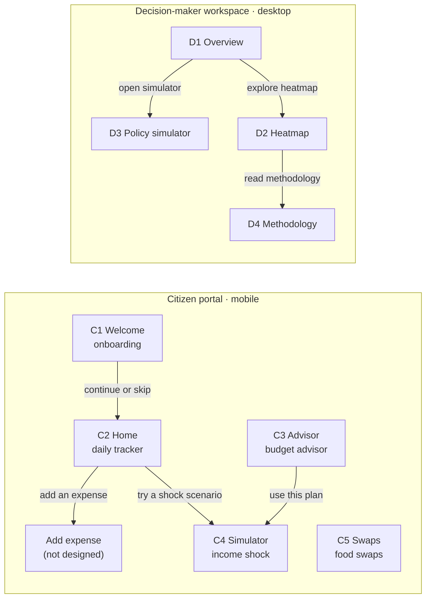

# Imibereho — Project Document

2026-10-24 · ISHIMWE Jean Claude

> **Provenance.** This is the repository copy of the Claude Docs artifact "Imibereho — Project Document" (https://claude.ai/artifact/U2pHfhfPSUL8sw1nRwb4WN). It was exported as Markdown on 2026-10-24. The artifact's navigation diagram (an interactive widget that does not survive Markdown export) is redrawn below in Mermaid. The *Technical approach* and *Risks* sections are updated to match `IMPLEMENTATION_PLAN.md` Draft v2.3 and API contract v0.2 rev 2, and are labelled as **planned**. The artifact itself still shows the earlier Draft v1 schedule; where they differ, this file and the plan win.
>
> **Labels:** **[E]** shown in the Figma design · **[Decided]** resolved by the project owner on 2026-10-24 · **[Planned]** proposed in the implementation plan, not yet approved · **[SYN]** invented synthetic input.

## Overview

Imibereho ("livelihood / well-being" in Kinyarwanda) is a household financial-resilience tool for Rwanda. It is to be delivered as a hackathon demo on synthetic data [Decided, Q-01]. The delivery deadline is 28 October 2026, set by the project schedule (not part of Q-01 or any other Q-xx). It has two parts, designed in 9 Figma screens [E]:

| Part | Device | Screens | Who it serves |
| --- | --- | --- | --- |
| Citizen portal | Mobile, 390 px | C1–C5: onboarding, daily tracker, budget advisor, resilience simulator, seasonal food swaps | Households, anonymously |
| Decision-maker workspace | Desktop, 1440 px | D1–D4: macro overview, district heatmap, policy simulator, data methodology | Public planners such as NISR, MINALOC and NGOs |

Every screen labels itself an "ILLUSTRATIVE DEMO · Not official statistics", and the methodology is versioned "CONCEPT METHOD · v0.1" [E] `2:7333`. The product promises honesty and privacy: no account, no phone number, and "This prototype does not collect or save your details." [E] `2:6407`

Source: Figma file `I9eAVerX5fH8fsr5OgtkNs`, inspected on 24 October 2026; details in `docs/figma/design-inventory.md`.

## Users and decisions

Two roles use the product, and neither signs in.

| Role | What they do | Access |
| --- | --- | --- |
| Citizen / household member | Sees their budget, tracks spending, compares with a local reference, tests an income shock, gets food-swap ideas | Anonymous; "Continue without an account" [E] `2:6401` |
| Decision-maker / analyst | Reads aggregate pressure and district vulnerability, simulates cash support, checks the methodology | Open workspace; the avatar `2:6765` is decorative |

Four scoping decisions are settled [Decided]:

| Question | Decision |
| --- | --- |
| Q-01 Demo or production? | Hackathon demo on synthetic, clearly labelled data, built to production quality |
| Q-02 Store citizen data? | No. Citizen data stays on the device; no citizen accounts |
| Q-04 Decision-maker login? | None for the demo |
| Q-15 Backend stack | Python 3.12, FastAPI, PostgreSQL (18 for local development; 16 for CI and deployment, provisional pending compatibility verification), SQLAlchemy 2.0, Alembic, Pydantic v2, pytest, ruff, mypy, uv; local PostgreSQL managed through pgAdmin 4 for development; Render for hosting; Docker deferred to a later containerisation phase |

Team: one backend engineer and one frontend engineer (React + TypeScript + Vite in `frontend/`).

## Citizen portal (C1–C5)

The portal follows one demo household through every screen: Gasabo, 4 people, 180,000 RWF income, 150,000 RWF planned essentials, 60,000 RWF savings [E]. Every screen shows the demo notice and an EN / RW switch; C2–C5 share a bottom tab bar.

| Screen | Figma node | Purpose | Key content and demo values [E] |
| --- | --- | --- | --- |
| C1 Welcome | `2:6365` | Optional baseline, no account | District, household size and monthly income, all optional. "Continue without an account" or "Skip setup and explore the demo" |
| C2 Home / daily tracker | `2:6411` | Monthly balance and today's spending | 30,000 RWF left after the plan. Today, 7 October: beans & vegetables 3,500, bus fare 1,000, electricity 2,000 = 6,500 RWF. "Add an expense" button |
| C3 District budget advisor | `2:6491` | Compare the plan with a local reference | Food 60,000 vs 65,000 · Housing 45,000 vs 40,000 · Transport 18,000 vs 20,000 · Utilities 12,000 vs 10,000 · Other 15,000 vs 15,000. Both total 150,000 |
| C4 Resilience simulator | `2:6592` | What if income falls? | 20% cut for 3 months: income 144,000, gap 6,000 a month, 18,000 of savings used, 42,000 left, a 10-month buffer |
| C5 Seasonal agro swaps | `2:6666` | Food ideas by district and month | Rice 1 kg at 2,000 → sweet potatoes 2 kg at 1,600, a 400 RWF difference. Variety tip and "not live prices" caveat |

Each screen ends with a guidance note saying the figures are invented, not advice or official averages.

## Decision-maker workspace (D1–D4)

The workspace turns a synthetic sample of 3,000 households and 30 district scores into four planning views. A sidebar links them; every view carries the note "All figures, trends and vulnerability scores are synthetic demo values."

| Screen | Figma node | Purpose | Key content and demo values [E] |
| --- | --- | --- | --- |
| D1 Macro overview | `2:6734` | Household pressure at a glance | Filters: geography, period, household group. KPIs: 3,000 sample households · 180,000 RWF reference income · 83.3% essentials / income · 33.3% in deficit after a 20% shock (1,000 of 3,000). Essentials trend May–Oct 138k → 150k against 180k income. Income sources: wage 40%, agriculture 35%, informal enterprise 25% |
| D2 District heatmap | `2:6901` | Where vulnerability looks highest | 30 districts in an alphabetical tile grid, scored 0–100 in four bands. Selected Gasabo: 46 = 0.4 × 50 + 0.4 × 40 + 0.2 × 50. Top six: Nyagatare 74, Bugesera 71, Kirehe 68, Gatsibo 66, Gisagara 64, Nyaruguru 63 |
| D3 Policy simulator | `2:7134` | Test a cash-support response | 20% income loss, 3 months, 6,000 RWF support for 1,000 households → 18m RWF budget and a 0 RWF gap. Compares no shock / shock only / shock + support |
| D4 Data methodology | `2:7291` | What is behind every number | Formulas, data sources still to acquire (each "not connected", "to confirm" or "not validated"), boundaries and a pre-launch checklist |

The policy comparison on D3, per household over three months [E] `2:7233`:

| Per household | No shock | Shock only | Shock + support |
| --- | --- | --- | --- |
| Income per month (RWF) | 180,000 | 144,000 | 144,000 |
| Support per month (RWF) | 0 | 0 | 6,000 |
| Expenses per month (RWF) | 150,000 | 150,000 | 150,000 |
| Net monthly balance (RWF) | +30,000 | −6,000 | 0 |
| Savings after 3 months (RWF) | 150,000 | 42,000 | 60,000 |

## Calculations

Every number on screen comes from simple, deterministic arithmetic printed in the design itself, and each rule below reproduces the demo value exactly. Money is whole RWF; percentages are integers 0–100. How non-whole results are rounded is still open (Q-17; the plan proposes integer half-up).

| Rule | Formula | Demo check | Screens |
| --- | --- | --- | --- |
| BR-01 Monthly balance | income + support − essentials | 180,000 − 150,000 = 30,000 | C2, D3 |
| BR-02 Shocked income | income × (1 − reduction %) | 180,000 × 0.8 = 144,000 | C4, D3 |
| BR-03 Monthly gap | max(0, essentials − shocked income − support) | 6,000; with 6,000 support, 0 | C4, D3 |
| BR-04 / BR-05 Savings used and left | min(savings, gap × months); savings − used | 18,000 used, 42,000 left | C4 |
| BR-06 Runway | savings ÷ gap (none when gap = 0) | 60,000 ÷ 6,000 = 10 months | C4 |
| BR-07 Savings after N months | savings + N × net balance | 150,000 / 42,000 / 60,000 | D3 |
| BR-08 Transfer budget | support × households × months | 6,000 × 1,000 × 3 = 18,000,000 | D3 |
| BR-09 Vulnerability index | 0.4 × income instability + 0.4 × cost pressure + 0.2 × low buffer | 46 for Gasabo | D2 |
| BR-10 Band | 0–39, 40–59, 60–69, 70–100 | 46 → band 2 | D2 |
| BR-11 Essentials / income | essentials ÷ income | 83.3% | D1 |
| BR-12 Share in deficit | households with a gap ÷ sample | 1,000 ÷ 3,000 = 33.3% | D1 |
| BR-13 Budget difference | plan − reference, per category | Housing +5,000, food −5,000 | C3 |
| BR-14 Swap difference | price A − price B | 2,000 − 1,600 = 400 | C5 |
| BR-15 Daily total | sum of today's expenses | 6,500 | C2 |
| BR-16 Weights check | weights sum to 1.0 | 0.4 + 0.4 + 0.2 | D2 |

[Planned] The backend implements all of these except BR-15, which the frontend computes because expenses never leave the device (Q-02).

## Navigation and design system

Navigation is inferred from nav bars and link text; the Figma prototype links were not readable.

- The bottom tab bar links C2, C3, C4 and C5 in both directions.
- The sidebar links all four workspace views; the avatar has no menu.
- **No screen links the citizen portal to the workspace** (Q-30).

The file has no Figma components or variables, so the tokens below were read from raw values. Icons match the Lucide set by name. Two raster images (hillside `2:6379`, market produce `2:6692`) are static frontend assets.

| Token | Hex | Used for |
| --- | --- | --- |
| brand/primary | #296347 | Buttons, active nav, links |
| brand/deep | #193e2d | Sidebar, hero and outcome cards |
| brand/accent | #bacd9b | On-dark labels, chart bars, heatmap 40–59 |
| bg/canvas | #f6f4ed | Page background |
| bg/surface | #fffefa | Cards, inputs, tab bar |
| bg/surface-tinted | #e7eddf | Pills, demo bar, heatmap 0–39 |
| border/default | #dce0d5 | Borders, dividers |
| text/primary | #203c32 | Headings and body |
| text/muted | #68726a | Secondary text |
| warning/surface | #f3e7d2 | Guidance notes, heatmap 60–69 |
| warning/text | #94602b | Guidance text, negative values |
| danger/high | #a65a40 | Heatmap 70–100 |

Type: Lora for headings and figures, Inter for body and labels. Cards use radius 16 and padding 20; inputs and buttons are 48 px tall with radius 8.

## Technical approach [Planned — awaiting approval of `IMPLEMENTATION_PLAN.md` Draft v2.3]

The planned backend is a stateless, read-mostly API. It serves seeded synthetic reference data and runs the calculations, while citizen profiles, plans and expenses stay on the device [Decided, Q-02]. The authoritative contract is `docs/architecture/api-contract-proposal.md` v0.2 rev 2; this section only summarises it. All data routes live under `/api/v1` and are public; every data response carries `meta: { isIllustrative: true, methodologyVersion: "0.1" }`; errors follow RFC 9457 problem details. `/health` is the hosting health check; `/ready` reports database, migration and seed status.

**Local development (no Docker):** Python 3.12 with uv, against a local PostgreSQL server managed through pgAdmin 4, with separate development, test and migration-test databases. Render's native Python runtime hosts the demo. Docker is deferred to a later containerisation phase.

**Planned code structure:** routers call services; services hold business rules and call repositories (database queries only, read-only for the API) and the pure calculation functions. Only migrations and the seed framework write to the database. Connections never use a PostgreSQL superuser: the safety guard refuses one.

**Setup status (2026-10-24):** uv 0.13.5 is installed, and the local PostgreSQL 18 server is running. The PostgreSQL versions are 18 for local development and 16 for CI and deployment, provisional pending compatibility verification. Still open: write access to the GitHub repository for the account used here, and creating the non-superuser role and databases in pgAdmin (not yet verified).

| Endpoint | Tier | Screens |
| --- | --- | --- |
| `GET /districts`, `GET /expense-categories` | Core | C1, C2, C3, C5, D2 |
| `GET /budget-benchmarks` | Core | C3 |
| `POST /calculations/household-shock` | Core | C2, C4 |
| `GET /seasonal-swaps` | Core | C5 |
| `GET /district-vulnerability`, `GET /district-vulnerability/{code}` | Core | D2, D1 "look next" |
| `POST /calculations/policy-scenario` | Core | D3 |
| `GET /dashboard/filters`, `GET /dashboard/overview` (geography `all` only) | Core | D1 |
| `GET /health`, `GET /ready` (root) | Core | Hosting checks |
| `GET /demo-household`, `POST /calculations/budget-comparison`, rate limiting, `GET /methodology` | Optional | C1, C3, D4 |

[Planned, SYN] The 3,000 sample households will be generated from a fixed seed. The design's totals are hit exactly by construction (1,200 / 1,050 / 750 by income source; 1,000 in deficit after a 20% shock). The deficit households are chosen independently of district and vulnerability score.

[Planned] Delivery, one PR per step, each approved before the next starts:

| Day | Steps |
| --- | --- |
| Sat 24 Oct | Resolve the blockers (including the local PostgreSQL setup in pgAdmin); plan approval; project skeleton; errors, envelope and CORS; database, safety guards and test isolation |
| Sun 25 Oct | CI; **early Render deployment**; calculation module; reference data |
| Mon 26 Oct | Budget benchmarks, household shock, seasonal swaps, decision-maker dataset |
| Tue 27 Oct | District vulnerability, policy scenario, dashboard overview, hardening: **core demo complete** |
| Wed 28 Oct | Integration fixes; optional endpoints if time allows; code freeze 16:00 |

If time runs short, the optional endpoints are cut first: methodology, rate limiting, budget comparison, then demo household.

## Gaps, open questions and risks

The design shows only the populated "happy path". These pieces are missing:

- No Add expense screen, though C2 has the button (Q-07)
- No screen to enter the plan, category budgets or savings (Q-06)
- No expense history beyond today (Q-25)
- No Kinyarwanda screens, despite the EN / RW switch (Q-03)
- No dropdown option lists, so allowed values for every select are unknown (Q-20)
- No loading, empty, error or offline states (Q-27); no tablet or mobile-workspace layouts (Q-28)

Open questions, with the answer the plan proposes [Planned, not decided]:

| Question | Proposed answer |
| --- | --- |
| Q-05 / Q-06 What "Skip setup" loads; where the plan and savings come from | A fixed demo household (optional endpoint, or bundled by the frontend) |
| Q-09 How the C3 insight is written | Largest difference above and below the reference; the frontend writes the sentence |
| Q-12 Is curated content in the backend? | Structured data yes; prose and images stay in the frontend |
| Q-14 Filter options and effects | Period October only, group all only, geography all only |
| Q-16 Where citizen calculations run | On the server, nothing stored or logged; product to confirm the C1 wording |
| Q-17 Rounding | Whole RWF rounded half up (same rule in Python and SQL); runway to 1 decimal; integer scores |
| Q-20 Allowed input values | Household size 1–20, percentages 0–100, duration 1–24 months |
| Q-32 Do benchmarks vary by district? | No; one illustrative set for household size 4 |
| Q-03 Kinyarwanda | English only in v1 |

Main risks:

| Risk | Mitigation [Planned] |
| --- | --- |
| A deployment problem late in the week | Render deployment on 25 Oct with auto-deploy for every step |
| Frontend integration happens late | Contract v0.2 and the live URL shared from 25 Oct |
| Invented inputs (29 districts' components, 3,000 households) could be read as findings | Labelled synthetic; no per-district aggregates; the design itself says the inputs are invented |
| Render free tier limits | A paid instance for demo week, or warm it before the demo |
| Demo numbers treated as official data | Every response and screen carries the illustrative flag |
