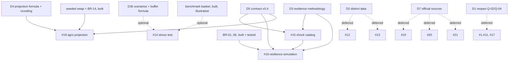

# Missing API implementation plan (audit of `MISSING_APIS.pdf`)

> **Status:** revision 13 (2026-10-28). Revision 3 implemented the scope; revision 4 recorded the follow-up on the nine incomplete endpoints; revision 5 records the project owner's approval of the PDF's example values as illustrative data (contract §11.7). **Of the nine, seven are complete (#12, #15, #18, #19, #20 outright; #14 and #16 with one documented deviation each) and two are partial (#13, #21)**, for the reasons in §0. The frontend teammate has not signed off contract v0.4 (contract §11). Revision 2's planning text below is kept as history.
>
> **Input:** `MISSING_APIS.pdf` at the repository root (untracked; 11 pages; "Missing Backend APIs Specification", dated 26 October 2026, target delivery 28 October 2026; SHA-256 `489ed788bb908a649f0cbaa91c3be97d3128319ed520c6b9c82b6e4ee0a1dd93`). The original request named `MISSING_API.pdf`; no file with that name exists.
>
> **Evidence labels:**
> - **[V]** verified in this repository: route registry, code, tests or documents.
> - **[A]** assumption.
> - **[R]** recommendation awaiting approval.
> - **[U]** unverified: no source in the repository.

## 0. Implementation status (revision 5)

**Decisions taken by the backend under the project owner's authority (2026-10-27).** The formulas are BR-17 to BR-23 in `backend-requirements.md` §2; the contract is §11.
- **D3:**
  - The PDF's shock and lever ids.
  - Lever amounts that reproduce the PDF example: 12,000 / 5,200 (the BR-20 projection) / 25,000 once.
  - Lump sums spread over the duration.
  - Runway per BR-06, which is `null` with no gap (the PDF shows 14.2).
  - The score is BR-19, based on the frontend heuristic: 95 / +28 (the PDF shows 88 / "+26"). It's an integer.
- **D4:**
  - The month is exactly 52/12 weeks, rounded half up. That gives **5,200**, as in the PDF; the frontend's 4.33 gives 5,196.
  - `householdSize` is validated but doesn't scale.
  - A swap resolves whatever its month.
  - Purchasing-power equivalents are `[]` with `awaiting_validated_data`.
- **D5:**
  - Routes exactly as in the PDF, including its snake_case query names.
  - `meta` added to every response, and integers instead of strings.
  - A new `swap-not-found` 404.
  - `household-shock` unchanged.
- **D3b:** scenarios `food_inflation_15` and `rent_surge_10`. `bufferImpactMonths` is BR-22, giving −0.8 where the PDF's −1.2 can't be derived.
- **Catalogues:** versioned constants (`app/core/resilience_catalog.py`, `app/core/stress_scenarios.py`). No migration; the head stays `0008`.
- **Revision 5 (owner approval, 2026-10-27):** the PDF's example values are served as illustrative data with `meta.provenance: "MISSING_APIS.pdf example, owner-approved"` (`app/core/pdf_examples.py`, contract §11.7). They supersede, for those values only, the D3/D4 items above that left them out (Musanze basket, staples, purchasing power, plate, checklist, harvest disruption). Score and buffer impact keep BR-19 and BR-22, with the evidence in contract §11.1 and §11.3.

| # | Endpoint | Outcome | Evidence (tests) |
|---|---|---|---|
| 15 | `GET /shocks/catalog` | **Complete** (illustrative): the PDF's three shocks plus `harvest_disruption` with `null` defaults | `tests/api/test_resilience.py`, `tests/unit/test_services/test_resilience.py` |
| 16 | `POST /calculations/resilience-simulation` | **Complete, one documented deviation**: the PDF's figures exactly except the score (BR-19: 95 / +28 integer vs 88 / "+26", no stated formula) | same; plus `tests/security/test_privacy.py::test_calculation_requests_write_nothing` |
| 18 | `POST /calculations/agro-savings-projection` | **Complete** (illustrative): the PDF example exactly, including the equivalents (BR-25) | `tests/api/test_agro_projection.py`, BR-20 tests in `test_resilience.py` |
| 14 | `POST /calculations/stress-test` | **Complete, one documented deviation**: totals as in the PDF; `bufferImpactMonths` BR-22 −0.8 vs −1.2 (no stated formula); any household size (BR-24) | `tests/api/test_district_advisor.py`, `tests/unit/test_services/test_district_advisor.py` |
| 12 | `GET /calculations/district-comparison` | **Complete** (illustrative): the PDF example exactly (Gasabo vs Musanze); other districts use the shared benchmark | same |
| 13 | `GET /districts/{code}/basket-details` | Partial: the PDF example exactly for Gasabo (`status: available`); the other 29 districts `awaiting_validated_data` with staple prices and hub `null` (open decision 1, contract §11.7; sources checked in `district-price-evidence.md`) | same |
| 20 | `GET /agro/harvest-calendar` | **Complete**: official NISR SAS 2025 calendar and production (source `sas-2025`); Kinyarwanda season name omitted (sources disagree) | `tests/api/test_harvest_calendar.py` |
| 19 | `nutrition/indyo-yuzuye` | **Complete** (illustrative): the PDF example, not presented as official guidance | `tests/api/test_agro_content.py` |
| 21 | `market/shopping-checklist` | Partial: the PDF example for Gasabo at size 4 (totals served as given; items sum to 4,750) and BR-24-modelled at sizes 1–20 (`valueBasis`); other districts `awaiting_validated_data` (open decisions 2 and 4, contract §11.7; evidence in `district-price-evidence.md`) | same; `tests/unit/test_services/test_pdf_examples.py` |
| 1–2 | `POST /auth/register`, `POST /auth/login` | **Complete** (revision 8, owner direction 2026-10-28): the PDF's fields exactly; contract v0.5 §11.8 | `tests/api/test_auth.py`, `tests/unit/test_security.py`, `tests/security/test_privacy.py` |
| 3–4 | `GET` / `PATCH /user/profile` (PDF: `PUT`) | **Complete** (revision 10): GET exactly as the PDF; PATCH instead of PUT at the owner's direction; its body is a contract extension derived from GET, approved 2026-10-28, not from the PDF (contract v0.6 §11.9) | `tests/api/test_profile.py` |
| 5–11 | `/tracker/*` | **Complete** (revision 12): PDF bodies followed where given; PATCH instead of PUT; PATCH/DELETE bodies, burn-rate, BR-26/BR-27, pagination and Idempotency-Key are contract extensions (contract v0.7 §11.10) | `tests/api/test_tracker.py`, `tests/unit/test_tracker_rules.py` |
| 17 | `POST /user/resilience-plan` | **Blocked by Q-02**; not served | `tests/api/test_routes.py::test_privacy_blocked_pdf_endpoints_are_not_served` |

The route registry, privacy, layering, migration and seed checks are in the final report of this session. Contract §11.6 holds the full reconciliation.

## 1. Executive summary

- **Constraints kept [V].** Q-02 (no server-side storage of citizen data) and Q-04 (no login) stay resolved as recorded in `docs/requirements/open-questions.md` and contract §1 ("Auth: None", "Citizen data: never stored"). `tests/security/test_privacy.py` keeps enforcing them. This plan builds nothing that authenticates users or stores citizen data.
- **[V] None of the 21 endpoints exists.** The route registry (`create_app("dev")`, walked with `fastapi.routing.iter_route_contexts`) serves 16 routes under `/api/v1`, plus `/health` and `/ready`.
- **Deadline scope [R], in this order:**
  1. **Phase 1:** #15 `GET /api/v1/shocks/catalog` and #16 `POST /api/v1/calculations/resilience-simulation`. Blocked on D3 and D5.
  2. **Phase 2:** #18 `POST /api/v1/calculations/agro-savings-projection`. Blocked on D4 and D5.
  3. **Optional:** #14 `POST /api/v1/calculations/stress-test`, only if time remains before the planned code freeze (Wed 28 Oct 16:00, `docs/PROJECT_DOCUMENT.md`) **and** D3b is approved.
- **Deferred:**
  - #12, #13 and #19–#21 until their data or methodology prerequisites are met (D2, D7).
  - #1–#11 and #17, the accounts and persistence APIs, unless the product owner formally reopens Q-02/Q-04 (D1).
- **No migrations for the deadline scope [R]:**
  - Phase 1 keeps its catalogue as versioned code constants (§6).
  - Phase 2 reads the already-seeded swap table.
  - Alembic head stays `0008` [V].
- **No values are invented.** Shock amounts, coping-relief amounts, the resilience-score formula, district data, market prices, nutrition guidance and harvest dates come only from approved decisions or cited sources. Until then the fields are specified by type only.

## 2. Audit of the 21 endpoints

**Status values:**
- `ALREADY_IMPLEMENTED`
- `PARTIALLY_IMPLEMENTED`
- `MISSING`
- `BLOCKED_BY_DECISION`

"Spec" says whether the PDF gives request and response examples. **Scope** is the deadline recommendation.

| # | Method and route | PDF priority | Spec | Status | Related code that exists [V] | Gaps and contract differences | Blocked by | Scope |
|---|---|---|---|---|---|---|---|---|
| 1 | `POST /api/v1/auth/register` | HIGH | yes | **IMPLEMENTED** (revision 8, 2026-10-28) | `household_accounts` (migration 0009), Argon2id, HS256 tokens | Stores a phone number or email, a password hash and the profile; a Q-02 change for that table (Option C), Q-04 unchanged | contract §11.8 | Done |
| 2 | `POST /api/v1/auth/login` | HIGH | yes | **IMPLEMENTED** (revision 8, 2026-10-28) | as #1 | One 401 for unknown identifier and wrong password | contract §11.8 | Done |
| 3 | `GET /api/v1/user/profile` | HIGH | yes | **IMPLEMENTED** (revision 10, 2026-10-28) | `household_accounts` + migration 0010; current-account dependency | The PDF's response fields exactly; `plannedEssentials`/`savingsBuffer` null until set | contract §11.9 | Done |
| 4 | `PUT /api/v1/user/profile` | MEDIUM | **no** (no body in the PDF) | **IMPLEMENTED as `PATCH`** (revision 10, owner direction) | as #3 | Body: a contract extension derived from the GET shape (not in the PDF), approved by the owner 2026-10-28; `PUT` gives 405 | contract §11.9 | Done |
| 5 | `GET /api/v1/tracker/overview` | CRITICAL | yes | **IMPLEMENTED** (revision 12, 2026-10-28; contract §11.10) | `monthly_balance` (BR-01) in `backend/app/calculations.py` | `totalSpentSoFar` needs stored transactions. `dailyBudgetHealth` has no definition [U]. Q-08 is open | D1, Q-08 | Done |
| 6 | `GET /api/v1/tracker/transactions` | CRITICAL | yes | **IMPLEMENTED** (revision 12, 2026-10-28; contract §11.10) | `expense_categories` seed | Persisted personal records. Q-07 and Q-11 are open | D1 | Done |
| 7 | `POST /api/v1/tracker/transactions` | CRITICAL | yes | **IMPLEMENTED** (revision 12, 2026-10-28; contract §11.10) | none | `newMonthlySpentTotal` would have to come from the server | D1 | Done |
| 8 | `PUT /api/v1/tracker/transactions/{id}` | MEDIUM | **no** | **IMPLEMENTED as `PATCH`** (revision 12, 2026-10-28; contract §11.10) | none | No body in the PDF: contract extension | D1, spec | Done |
| 9 | `DELETE /api/v1/tracker/transactions/{id}` | MEDIUM | **no** | **IMPLEMENTED** (revision 12, 2026-10-28; contract §11.10) | none | No specification | D1, spec | Done |
| 10 | `GET /api/v1/tracker/daily-trend` | HIGH | yes | **IMPLEMENTED** (revision 12, 2026-10-28; contract §11.10) | none | Needs #7's stored data | D1 | Done |
| 11 | `GET /api/v1/tracker/burn-rate` | MEDIUM | **no** | **IMPLEMENTED** (revision 12, 2026-10-28; contract §11.10) | `runway_months` (BR-06) | No specification and no formula [U] | D1, spec | Done |
| 12 | `GET /api/v1/calculations/district-comparison` | CRITICAL | yes | PARTIALLY_IMPLEMENTED | `BenchmarkService.reference_amounts` (`backend/app/services/benchmark_service.py`); `budget_comparison` (BR-13); tests `test_benchmark_design_values`, `test_every_district_has_the_illustrative_set`, `test_other_household_size_is_benchmark_not_available` | Every district has the same illustrative basket (Q-32 [PD]), so A vs B is always 0. Only household size 4 exists. The query is snake_case and the response has no `meta`. The Musanze figures have no source [U] | D2 | Deferred |
| 13 | `GET /api/v1/districts/{code}/basket-details` | HIGH | yes | BLOCKED_BY_DECISION | district reference data only | Rent, transit, staple prices and market hub have no source [U] | D2, D7 | Deferred |
| 14 | `POST /api/v1/calculations/stress-test` | MEDIUM | yes | PARTIALLY_IMPLEMENTED | benchmark basket as above | No scenario list (Q-10 lists `income_fall` only). `bufferImpactMonths` has no formula, and no savings or income in the request [U]. The PDF example 65,000 × 15% = 9,750 matches the seeded food line [V] | D3b, D5 | Optional |
| 15 | `GET /api/v1/shocks/catalog` | HIGH | yes | BLOCKED_BY_DECISION (values) | `Shock.type: Literal["income_fall"]` (`backend/app/schemas/shock.py`, [PD] Q-10) | The PDF and `frontend/src/data/mockResilienceData.ts` disagree on IDs and amounts, and the existing shock is called `income_fall`. Amounts have no source [U] | D3, D5 | **Phase 1** |
| 16 | `POST /api/v1/calculations/resilience-simulation` | CRITICAL | yes | PARTIALLY_IMPLEMENTED | `ShockService` and BR-01 to BR-06 (`shocked_income`, `monthly_gap`, `savings_drawdown`, `runway_months`); tests in `backend/tests/api/test_shocks.py`, `backend/tests/unit/test_services/test_calculations.py` | **Covered:** gap, drawdown, runway. The PDF's `rawMonthlyGap` 6,000 = 150,000 − 180,000 × 0.8 [V]. **Missing:** lump-sum shocks, levers, score. Lever IDs differ between the PDF and the frontend. The score exists only as a frontend heuristic (`ResilienceSimulatorPage.tsx`). `scoreChange` is a string. The PDF's `runwayMonths` 14.2 with `netMonthlyGap` 0 contradicts BR-06 ([PD] Q-17: `null` when there is no gap) | D3, D5 | **Phase 1** |
| 17 | `POST /api/v1/user/resilience-plan` | LOW | **no** | BLOCKED_BY_DECISION | none | Persistence plus auth; no specification | D1, spec | Deferred |
| 18 | `POST /api/v1/calculations/agro-savings-projection` | HIGH | yes | PARTIALLY_IMPLEMENTED | seeded swap `rice-to-sweet-potato` (`backend/app/data/seasonal.py`, prices "invented, not market observations"); `swap_difference` (BR-14) gives 400 [V]; tests in `backend/tests/api/test_seasonal_swaps.py` | The formula exists only in `MonthlySavingsProjector.tsx`. **Example mismatch: 400 × 3 × 4.33 = 5,196, but the PDF reports 5,200** (§5, D4). `householdSize` isn't used by that formula. The purchasing-power equivalents need prices with no source [U] | D4, D5 | **Phase 2** |
| 19 | `GET /api/v1/nutrition/indyo-yuzuye` | MEDIUM | yes | BLOCKED_BY_DECISION | none | Health guidance with no citation [U] | D7 | Deferred |
| 20 | `GET /api/v1/agro/harvest-calendar` | MEDIUM | yes | BLOCKED_BY_DECISION | none | The PDF says Season A is September–February, while the frontend mock maps September to C; no official source [U] | D7 | Deferred |
| 21 | `GET /api/v1/market/shopping-checklist` | HIGH | yes | BLOCKED_BY_DECISION | none | Prices have no source [U]; `unoptimizedBasket` has no definition | D2, D7 | Deferred |

**Totals:**
- `ALREADY_IMPLEMENTED`: 0
- `PARTIALLY_IMPLEMENTED`: 4 (#12, #14, #16, #18)
- `MISSING` (and unblocked): 0
- `BLOCKED_BY_DECISION`: 17

## 3. Reusable functionality [V]

| Piece | Location | Used by |
|---|---|---|
| BR-01 to BR-06: `monthly_balance`, `shocked_income`, `monthly_gap`, `savings_drawdown`, `runway_months` (1 dp half up, `None` when there is no gap) | `backend/app/calculations.py`; `tests/unit/test_services/test_calculations.py` (23 tests) | #16 |
| `swap_difference` (BR-14) and the seeded swap | `backend/app/calculations.py`, `ReferenceDataRepository.list_swaps`, `backend/app/data/seasonal.py` | #18 |
| Strict request models: `BodyModel` (camelCase, extra fields rejected, `not_integer`), `Baseline`, `Money` (0–100,000,000), `Percent` (0–100), `DurationMonths` (1–24), `NoQuery` | `backend/app/schemas/common.py`, `backend/app/schemas/shock.py` | #15, #16, #18 |
| Error mapping to contract §1.3 codes (`required`, `out_of_range`, `not_integer`, `unknown_value`, `unknown_field`) | `backend/app/core/errors.py`; `tests/api/test_errors.py` | all |
| Illustrative envelope `meta {isIllustrative: true, methodologyVersion: "0.1"}`, plus `count` on lists | `backend/app/schemas/common.py` | all |
| Versioned code-constant catalogues | `backend/app/core/constants.py` (`INCOME_SOURCES`, `VULNERABILITY_COMPONENTS`, `HOUSEHOLD_SHOCK_ASSUMPTIONS`, `POLICY_SCENARIO_ASSUMPTIONS`) | #15, #16 (§6) |
| Layering and privacy guards | `tests/unit/test_layering.py`, `tests/security/test_privacy.py` (`test_calculation_requests_write_nothing`) | all |

## 4. Cross-cutting findings [V]

1. **The frontend makes no API calls.** It reads `frontend/src/data/mock*.ts`. `PayloadModal.tsx` *displays* a `POST /api/v1/resilience/simulate` example, which is a different route from the PDF's.
2. **The PDF breaks contract §1 conventions:**
   - snake_case query parameters;
   - no `meta`;
   - `scoreChange` as a string, where numbers must be JSON numbers;
   - the shock type `income_drop` where the existing API uses `income_fall`.
3. **Contract status.** v0.2 rev 2 (§1–§8) still awaits sign-off; v0.3 (§10) was agreed on 2026-10-27. Every new endpoint needs a v0.4 entry (§7) before it ships.
4. **Provenance.** The existing benchmark and swap prices are labelled invented in the seed modules, and the PDF's numbers are examples. No response may present them as observed facts.

## 5. Decisions requiring confirmation (all open)

**None of these is approved.** Record each approval with its date, approver and exact wording before the dependent phase starts.

### D3: resilience methodology (blocks #15, #16)

| # | Question | Fields affected |
|---|---|---|
| D3.1 | Which shocks are in the catalogue (stable IDs, titles, and whether each is an income reduction or a lump sum)? Does `income_drop` replace or alias the existing `income_fall`? | #15 `items[].id`, `title`, `isLumpSum`; #16 `shock.type` |
| D3.2 | Default values per shock: percentage and duration for income shocks, amount for lump sums. Which source, or are they explicitly illustrative? | #15 `defaultPct`, `defaultDuration`, `defaultAmount` |
| D3.3 | For a lump-sum shock: does the client send the amount, or does the server always use the catalogue default? Is it deducted from savings once, and is it part of `rawMonthlyGap`? | #16 `shock.amount`; `rawMonthlyGap`, `totalEffectiveBuffer`, `runwayMonths` |
| D3.4 | Which coping levers exist (IDs, titles)? Is each one's effect a monthly relief amount, a one-off amount or a percentage? What are the amounts, and from what source? | #15 lever list (see D5.3); #16 `activeCopingLevers[]`, `copingReliefMonthly`, `lumpSumSupport` |
| D3.5 | How do levers combine? Is `netMonthlyGap = max(0, rawMonthlyGap − copingReliefMonthly)` and `totalEffectiveBuffer = savings + lumpSumSupport`? | #16 `netMonthlyGap`, `totalEffectiveBuffer` |
| D3.6 | Runway basis: BR-06 gives `runwayMonths = null` when the gap is 0, but the PDF example shows 14.2 (= 85,000 ÷ 6,000, using the *raw* gap) with `netMonthlyGap` 0. Is runway buffer ÷ net gap (BR-06 semantics) or buffer ÷ raw gap? | #16 `runwayMonths` |
| D3.7 | Resilience score: what formula (0–100, integer)? The only candidate in the repository is the frontend heuristic: baseline clamped to 45–75 from the raw gap, +7 per lever, +8 if the net gap is 0. Is it adopted (labelled illustrative), replaced, or left out of v0.4? | #16 `resilienceScore`, `scoreChange` |

### D4: agro-savings projection (blocks #18)

| # | Question | Fields affected |
|---|---|---|
| D4.1 | **Example mismatch.** 400 × 3 × 4.33 = 5,196 exactly; the PDF shows 5,200. Is 5,200 a typo, rounding to the nearest 100, or a different weeks-per-month factor? **No rounding rule is chosen in this plan.** | #18 `monthlyProjectedSavings` |
| D4.2 | Is the weeks-per-month factor 4.33 (frontend), 52/12, or something else? Is it shown in `assumptions`? | #18 `monthlyProjectedSavings`, `assumptions` |
| D4.3 | What does `householdSize` do? The frontend formula ignores it, and the seeded swap quantities are fixed per meal. Should it scale the result, or be dropped from the request? | #18 request `householdSize` |
| D4.4 | What is the allowed `mealsPerWeek` range? | #18 request `mealsPerWeek` |
| D4.5 | Does `swapId` resolve regardless of month? The seeded swap applies to month 10 only. | #18 `swapId`, 404 behaviour |
| D4.6 | Leave out `purchasingPowerEquivalents` until sourced prices exist (D7)? | #18 response |

### D5: contract v0.4 shape (blocks #15, #16, #18; and #14 if built)

| # | Question | Fields affected |
|---|---|---|
| D5.1 | Route names: the PDF's `/calculations/resilience-simulation` or the frontend's `/resilience/simulate`? `/shocks/catalog`? | routes |
| D5.2 | Adopt the §7 envelope: `meta` on every response; numbers never strings (so `scoreChange` becomes an integer); explicit `null` for fields that don't apply | all responses |
| D5.3 | Where does the coping-lever list come from: a `copingLevers` array in the #15 response, a separate route, or frontend copy? | #15 response |
| D5.4 | A new 404 slug for an unknown swap (proposed: `swap-not-found`; contract §1.3 limits `district-not-found` to districts) | #18 errors |
| D5.5 | Keep `household-shock` unchanged alongside #16 (recommended), or deprecate it? | existing route |

### Deferred decisions (not needed for the deadline scope)
- **D1:** reopen Q-02/Q-04. Owner: the product owner. Blocks #1–#11 and #17. **Outcome (revisions 8–9, 2026-10-28):** #1–#2 built at the owner's direction as a Q-02 change for citizen accounts only; Q-04 (decision-maker login) was not involved and is unchanged. #3–#11 and #17 stay blocked.
- **D2:** per-district data and household-size scaling (the frontend's `getHouseholdSizeFactor` has no source). Blocks #12, #13 and #21.
- **D3b:** stress scenarios and the `bufferImpactMonths` formula, plus where savings and income come from. Blocks #14.
- **D6:** whether to build the optional `GET /api/v1/demo-household`.
- **D7:** official sources for nutrition, harvest calendar and prices. Blocks #19–#21 and #18's equivalents.

## 6. Catalogue storage: code constants or database tables

| | Versioned constants module (no migration) | Database-managed seed tables (migration) |
|---|---|---|
| **Used for today [V]** | Fixed lists tied to code: `INCOME_SOURCES`, `VULNERABILITY_COMPONENTS`, assumption lists in `app/core/constants.py`, and `Shock.type` as a `Literal` | Design content served by data endpoints and joined or filtered by key: `expense_categories`, `budget_benchmarks`, `seasonal_swaps` (methodology-version scoped, covered by `/ready` and `seed --check`) |
| **Request validation** | Direct: `Literal`/enum in the Pydantic model gives 422 `unknown_value` with no database query | Needs a lookup in the service (as `require_district` does), adding a 404 or 422 path |
| **Change process** | Code change plus review; methodology version bumped if values change | Seed module change plus a reseed; `/ready` reports `seed: failed` until reapplied |
| **Drift risk** | None: the values aren't in the database | Detected by `seed --check` |
| **Deadline cost** | Low: no Alembic revision, no seed dataset, no migration tests | Revision `0009`, a dataset, a privacy-test allow-list entry, and migration and seed test updates |

**Recommendation [R]:**
- **Phase 1:** a dedicated versioned constants module (e.g. `backend/app/core/resilience_catalog.py`) tagged with `METHODOLOGY_VERSION`, holding the D3-approved shocks and levers. Values are pinned by unit tests. The catalogue is small and fixed per methodology version, it drives request validation, and it isn't joined with other tables. The existing architecture gives no reason to move it into the database.
- **Phase 2:** reuses the existing `seasonal_swaps` table; no new storage.
- **Switch to database tables only if** the catalogue must change without a deploy, be filtered by district or month, or be checked by `/ready`. None of these is a stated requirement [A].

## 7. Minimum contract v0.4 changes (proposal, pending D5)

**Common rules:**
- All paths under `/api/v1`; camelCase fields and query parameters.
- Every data response carries `meta {isIllustrative: true, methodologyVersion: "0.1"}`, and `count` for lists.
- Money is an integer RWF. Every numeric field is a JSON number, never a string.
- `runwayMonths` has 1 decimal place (§1); scores and percentages are integers.
- Bodies use `BodyModel` rules.
- Errors follow §1.3, with validation (400/422) before any lookup (404). Error responses carry no `meta`.
- Nothing is stored or logged (Q-02).
- Values are **types only** until D3/D4 are approved.

### #15 `GET /api/v1/shocks/catalog`
- **Query parameters:** none. Any parameter returns 400 `unknown-parameter` (`unknown_field`).
- **200 response:**

  ```json
  {
    "items": [
      {
        "id": "<slug>",
        "title": "<string>",
        "isLumpSum": false,
        "defaultPct": "<int 0-100 | null>",
        "defaultDuration": "<int 1-24 | null>",
        "defaultAmount": "<int RWF | null>"
      }
    ],
    "meta": { "isIllustrative": true, "methodologyVersion": "0.1", "count": "<n>" }
  }
  ```

  Every field is always present; a field that doesn't apply is `null`. That's the smallest change from the PDF, which omits fields instead. A `copingLevers` array is added only if D5.3 chooses it. The list has 30 items or fewer.
- **Errors:** 400 `unknown-parameter`, 405 `method-not-allowed`, 500 `internal`.

### #16 `POST /api/v1/calculations/resilience-simulation`
- **Request:**

  ```json
  {
    "baseline": { "monthlyIncome": "<Money>", "monthlyEssentials": "<Money>", "savings": "<Money>" },
    "shock": {
      "type": "<catalogue id>",
      "incomeReductionPct": "<Percent>",
      "durationMonths": "<DurationMonths>",
      "amount": "<Money, only if D3.3 allows it>"
    },
    "activeCopingLevers": ["<lever id>"]
  }
  ```

  The client never sends relief amounts, totals or scores; any such field is an extra field (422 `unknown_field`).
- **Validation (422 `validation`):**
  - Missing fields: `required`.
  - Out-of-bounds values (`Money`, `Percent`, `DurationMonths`): `out_of_range`.
  - Non-integers: `not_integer`.
  - An unknown `shock.type`: `unknown_value` at `shock.type`.
  - An unknown or duplicate lever: `unknown_value` at `activeCopingLevers.<i>`, matching the existing duplicate rule for budget comparison.
  - A parameter not valid for the shock kind, e.g. `incomeReductionPct` on a lump-sum shock: `unknown_field`.
- **200 response:**

  ```json
  {
    "rawMonthlyGap": "<int>",
    "copingReliefMonthly": "<int>",
    "lumpSumSupport": "<int>",
    "netMonthlyGap": "<int>",
    "totalEffectiveBuffer": "<int>",
    "runwayMonths": "<number, 1 dp | null>",
    "resilienceScore": "<int 0-100>",
    "scoreChange": "<int>",
    "assumptions": ["<string>"],
    "meta": { "isIllustrative": true, "methodologyVersion": "0.1" }
  }
  ```

  `resilienceScore` and `scoreChange` ship only if D3.7 approves a formula; otherwise they're absent from v0.4. `rawMonthlyGap` must equal BR-03 (`monthly_gap(essentials, shocked_income(income, pct))`) for income shocks.
- **Errors:** 400 `malformed-request`, 405, 422 as above, 500. There is no 404 path, because the catalogue is in code.

### #18 `POST /api/v1/calculations/agro-savings-projection`
- **Request:** `{ "swapId": "<slug>", "mealsPerWeek": "<int, range per D4.4>", "householdSize": "<int 1-20, only if D4.3 keeps it>" }`. The 1–20 bound is the existing `HOUSEHOLD_SIZE_MIN`/`MAX`.
- **200 response:**

  ```json
  {
    "swapId": "<slug>",
    "perMealSavings": "<int: swap_difference(fromPrice, toPrice)>",
    "monthlyProjectedSavings": "<int, rounding per D4.1/D4.2>",
    "assumptions": ["<string>"],
    "meta": { "isIllustrative": true, "methodologyVersion": "0.1" }
  }
  ```

  `purchasingPowerEquivalents` isn't in v0.4 (D4.6, D7).
- **Errors:** 400 `malformed-request`, 405, 422 `validation`, and 404 `swap-not-found` (D5.4) for an unknown `swapId`, checked after validation. 500.

## 8. Implementation order

1. **Phase 0: decisions D3, D4, D5.** These are owned by the frontend teammate and the project owner. Record each approval.
2. **Phase 1: #15 and #16.**
   - **Reuse:** BR-01 to BR-06 through `app/calculations.py`; `Baseline`, `Percent`, `DurationMonths`, `NoQuery`.
   - **New pieces:**
     - pure functions for the D3-approved lever, lump-sum and score rules (`app/calculations.py`, BR-17 onward added to `docs/architecture/backend-requirements.md` §2);
     - the catalogue constants module (§6);
     - `schemas/resilience.py`, `services/resilience_service.py`, `api/v1/endpoints/resilience.py`, registered in `api/v1/router.py`.
   - **Unchanged:** `household-shock` (D5.5).
   - **Migration:** none.
3. **Phase 2: #18.**
   - **Reuse:** `ReferenceDataRepository` and `swap_difference`; a new pure projection function per D4.
   - **Migration:** none.
4. **Optional, Phase 3: #14.** Only if Phases 1–2 are complete with every check green, time remains before the freeze, and D3b is approved.
   - **Reuse:** `BenchmarkService.reference_amounts`.
   - **Migration:** none, with scenarios as constants.
5. **Deferred:**
   - #12, #13 and #21 until D2/D7;
   - #19 and #20 until D7;
   - #1–#11 and #17 unless D1 formally reopens Q-02/Q-04.

   If D1 is ever approved, that work needs auth, a write-capable session, ownership checks, privacy-policy and consent changes, and deliberate privacy-test changes. It's out of scope for this deadline.



## 9. Acceptance checklists (per approved endpoint)

An endpoint is complete only when every box is ticked **with recorded evidence**: command output or test names in the PR description. Proposed test names are given; the files don't exist yet.

### Common gates (run from `backend/`)
- [ ] D3/D4/D5 approval recorded, and a v0.4 row added to the contract's §9 change log (`docs/architecture/api-contract-proposal.md`).
- [ ] `uv run ruff check .` and `uv run ruff format --check .` clean.
- [ ] `uv run mypy app tests alembic scripts` clean (strict).
- [ ] `uv run pytest --cov=app --cov-fail-under=85`: all pass. Only the 2 CI-only superuser skips are allowed.
- [ ] `uv run python -m app.db.migrate --target migrations check` reports "No new upgrade operations detected", and `uv run python -m app.db.migrate --target dev current` shows `0008 (head)` (no migration, §6).
- [ ] `uv run python -m app.db.seed --target test --check` and `--target dev --check` report all datasets match.
- [ ] `tests/api/test_routes.py::test_routes_equal_the_implemented_endpoints` passes with the new routes added to `EXTENSION_ENDPOINTS`.
- [ ] `tests/security/test_privacy.py` passes unchanged, apart from adding the new POST routes to `test_calculation_requests_write_nothing`. `test_only_approved_tables_exist_in_the_models` is unchanged, since no new tables are added.
- [ ] `tests/unit/test_layering.py` passes.
- [ ] A live smoke test (`uv run uvicorn app.main:app --no-access-log --port 8020`, then a request to each route) shows the expected status codes and `meta`; the server log has no request bodies.
- [ ] `git diff --check` is clean, `git status --short -- frontend` is empty, and no `nisr/` files are staged.

### #15 shock catalogue
- [ ] `tests/api/test_shock_catalog.py`:
  - `test_catalog_items_match_the_approved_d3_catalogue`: every value equals the recorded D3 values;
  - `test_every_field_present_with_null_when_not_applicable`;
  - `test_meta_is_illustrative_with_count`;
  - `test_unknown_query_parameter_is_400`;
  - `test_wrong_method_is_405`;
  - `test_openapi_types` (`defaultAmount` is `integer | null`, `isLumpSum` is `boolean`).
- [ ] `tests/unit/test_services/test_resilience_catalog.py::test_catalogue_ids_unique_and_slugs`.

### #16 resilience simulation
- [ ] `tests/unit/test_services/test_calculations.py`:
  - one test per new BR rule;
  - `test_raw_gap_equals_br03_for_income_shocks`: PDF vector 180,000 / 150,000 / 20% gives 6,000 [V];
  - D3-approved vectors for relief, lump sum, runway (D3.6) and score (D3.7).
  - The PDF's 17,200 / 25,000 / 14.2 / 88 are used only if D3 confirms them.
- [ ] `tests/api/test_resilience_simulation.py`:
  - `test_approved_example_values`;
  - `test_no_gap_gives_null_runway` (unless D3.6 decides otherwise);
  - `test_body_integer_matrix`;
  - `test_out_of_range`;
  - `test_unknown_shock_type_is_unknown_value`;
  - `test_unknown_or_duplicate_lever_is_unknown_value`;
  - `test_client_supplied_totals_are_unknown_field`;
  - `test_malformed_json_is_400`;
  - `test_wrong_method_is_405`;
  - `test_numbers_are_json_numbers` (raw JSON: `scoreChange` is an integer);
  - `test_openapi_types`.
- [ ] `tests/api/test_shocks.py` passes unchanged, so `household-shock` doesn't regress.

### #18 agro-savings projection
- [ ] `tests/unit/test_services/test_calculations.py::test_agro_projection_vectors`: 400 per meal [V]; the monthly value per the approved D4.1/D4.2 rule. This test is where the 5,196 vs 5,200 decision is recorded.
- [ ] `tests/api/test_agro_projection.py`:
  - `test_seeded_swap_projection`;
  - `test_unknown_swap_is_404_swap_not_found`;
  - `test_validation_precedes_lookup` (invalid `mealsPerWeek` with an unknown swap gives 422);
  - `test_meals_per_week_bounds`;
  - `test_household_size_rule` (per D4.3);
  - `test_no_purchasing_power_field`;
  - `test_wrong_method_is_405`;
  - `test_openapi_types`.

### #14 stress test (only if built)
- [ ] D3b recorded.
- [ ] `test_food_15_vector`: baseline 150,000, stressed 159,750, increase 9,750 [V].
- [ ] `bufferImpactMonths` tested only per the approved D3b formula.
- [ ] Unknown district gives 404 `district-not-found`; another household size gives 404 `benchmark-not-available`.

## 10. Risks and data provenance

- **Deadline.** Phases 1–2 fit only if D3, D4 and D5 are decided on 27 Oct. Without D3, start Phase 2, which needs only D4 and D5.
- **Invented values.** The PDF example figures and the frontend mock amounts have no source [U]. They enter the API only as approved values, labelled `isIllustrative: true`, never as observed data. EICV7 and FinScope stay separate datasets (contract §10).
- **Contract drift.** Shipping the PDF's shapes verbatim would break §1 conventions; prevented by D5 and the v0.4 entry.
- **Double maintenance.** The frontend computes these values locally today, so it should switch to the API once each endpoint ships.

## 11. Next feature recommended

**[R] Phase 1 (#15 + #16), as soon as D3 and D5 are recorded.** It's the PDF's CRITICAL item compatible with Q-02/Q-04. Its gap, drawdown and runway come from the tested BR-01 to BR-06 engine, it needs no external data and no migration, and it completes a page the frontend already built. If D3 can't be decided in time, start Phase 2 (#18) once D4 and D5 are recorded.

## Revision history

| Revision | Date | Change |
|---|---|---|
| 1 | 2026-10-27 | First audit and plan. |
| 2 | 2026-10-27 | Deadline-focused review. Q-02/Q-04 kept with no auth or persistence in scope. Scope fixed as Phase 1, Phase 2, then optional #14. Catalogue migration replaced by a versioned constants module, with a comparison (§6). The 5,196 vs 5,200 mismatch recorded as D4.1 without choosing a rounding rule. D3/D4/D5 broken into exact questions with the fields affected. Minimum v0.4 contract changes added (§7). Per-endpoint acceptance checklists with commands added (§9). Persistence order removed from scope. |
| 3 | 2026-10-27 | Implemented under the project owner's authority: decisions recorded in §0, status per endpoint, contract v0.4 §11. |
| 4 | 2026-10-27 | Owner-approved: BR-24 square-root household-size scaling (#12, #14), the PDF's runway (#16), integer `scoreChange`. #20 served from NISR SAS 2025. Using the PDF's example values as illustrative data was put to the owner twice and not approved, so #12, #13, #15, #18, #19 and #21 stay partial or awaiting data. |
| 5 | 2026-10-27 | The project owner approved the PDF's example values as illustrative data (provenance "MISSING_APIS.pdf example, owner-approved"). Served for #12, #13, #15, #16, #18, #19 and #21 (contract §11.7); BR-25 added; score and buffer-impact deviations documented with evidence. Status: seven of the nine complete (two with one documented deviation), #13 and #21 partial. |
| 6 | 2026-10-27 | Gap review of #13 and #21 against the PDF, contract and Q-32: `status` added to `basket-details` (`awaiting_validated_data` for the 29 districts without staple prices or hub); validation-order, case-sensitivity, all-30-district and OpenAPI tests added; open decisions 1–4 recorded in contract §11.7. Both stay partial: no further approved or sourced data exists. |
| 7 | 2026-10-27 | Source research for #13 and #21 (WFP market prices on HDX, NISR CPI September 2026, MINAGRI e-Soko), recorded with hashes and candidate values in `district-price-evidence.md`: no source covers all three staples or a primary market for any district, so nothing new is served. Owner-approved BR-24 scaling of the Gasabo checklist to sizes 1–20, labelled `valueBasis: modelled_from_pdf_example`. Both stay partial. |
| 8 | 2026-10-28 | At the project owner's direction, #1 `POST /auth/register` and #2 `POST /auth/login` implemented exactly as the PDF shows them (contract v0.5 §11.8): `household_accounts` (migration 0009), Argon2id, HS256 tokens, `JWT_SECRET_KEY`. A Q-02 change for that table only (Option C); Q-04 unchanged. #3–11 and #17 stay unserved. |
| 9 | 2026-10-28 | Security review fixes: ASCII-only identifiers (lookalikes rejected); a current-account dependency for future protected routes (401 `not-authenticated`), with CORS allowing `Authorization`; the decision records corrected (Q-02 changed for accounts; Q-04 unchanged; Q-13 open; Q-34 added for the design copy). No endpoint added. |
| 10 | 2026-10-28 | At the project owner's direction, #3 `GET /user/profile` and #4 as `PATCH /user/profile` (not the PDF's `PUT`; the PDF gives the update no body, so it is derived from the GET shape). Migration 0010 (`planned_essentials`, `savings_buffer`, `updated_at`); CORS allows PATCH; 405 `Allow` lists every method of a path. Contract v0.6 §11.9. |
| 11 | 2026-10-28 | The project owner approved the derived PATCH body as a contract extension (the PDF lists `PUT` with no body); recorded as an implementation decision in contract §11.9, not as PDF content. |
| 12 | 2026-10-28 | At the project owner's direction, #5–#11, the daily tracker (contract v0.7 §11.10): migration 0011, BR-26, BR-27, PATCH in place of the PDF's PUT, DELETE, keyset pagination, Idempotency-Key. Contract extensions where the PDF gives no body are labelled as such. #17 stays unserved. |
| 13 | 2026-10-28 | Pre-commit review of the tracker. F1: the contract said an idempotent replay "returns the first response"; it returns the same `id` with the transaction as it is now, so the wording was corrected and a regression test pins it. F2: after a delete, a late retry with the same key records the transaction again; fixing it means keeping used keys after a delete (a retention decision, Q-13), so it is documented as a known limitation with a test, pending the owner. The tracker's contract extensions remain **pending owner approval** (contract §11.10). |
